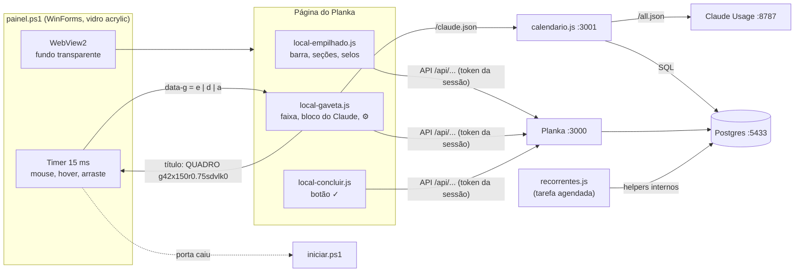

# Planka Gaveta

Complementos para um [Planka](https://github.com/plankanban/planka) **2.2.1** rodando no próprio
Windows, sem Docker: o quadro vira uma **gaveta de vidro** presa na borda da tela, sempre por cima
das outras janelas. Fechada, ela é uma faixa fina com a hora, o uso do Claude e um ponto colorido
por prazo. Passou o mouse, ela abre com o quadro inteiro; tirou o mouse, ela fecha.

Junto vêm scripts que mudam o visual do Planka (listas empilhadas, selos de prazo, botão de
concluir), um calendário de prazos com assinatura `.ics`, cartões recorrentes e um importador
do Trello.

**Para quem serve:** quem usa o Planka sozinho, num PC com Windows 10/11, e quer o quadro sempre
à vista sem dedicar uma janela ou um monitor a ele. Não serve para servidor compartilhado nem
para quem roda o Planka no Docker ou em outra máquina (os caminhos e portas são locais, veja
[Limitações](#limitações)).

Este repositório **não inclui o Planka**. Só os arquivos que vão ao lado dele.

<!-- O print docs/gaveta.png ainda será feito: gaveta fechada (faixa) e aberta (quadro), lado a lado. -->


---

## Sumário

1. [Por que existe](#por-que-existe)
2. [Recursos](#recursos)
3. [Requisitos](#requisitos)
4. [Instalação passo a passo](#instalação-passo-a-passo)
5. [Parâmetros do painel.ps1](#parâmetros-do-painelps1)
6. [Como funciona por dentro](#como-funciona-por-dentro)
7. [Integração opcional com o Claude Usage](#integração-opcional-com-o-claude-usage)
8. [Problemas comuns](#problemas-comuns)
9. [Limitações](#limitações)
10. [Licença](#licença)

---

## Por que existe

Um quadro kanban só ajuda se você olha para ele. Numa aba do navegador ele some atrás de tudo;
numa janela fixa ele ocupa espaço o dia inteiro. A gaveta resolve os dois lados: fica sempre
visível como uma faixa de poucos pixels na borda da tela e mostra, sem abrir nada, se há prazo
atrasado (ponto vermelho), vencendo (amarelo) ou tranquilo (verde).

O Planka é *fair-code* e alguns recursos (como cartões recorrentes) ficam na versão paga. Os
scripts daqui recriam o que faltava por fora, usando a API e os helpers internos do próprio
Planka, sem alterar o código dele (exceto duas linhas de `<script>` no template da página).

---

## Recursos

### Gaveta de vidro (`painel.ps1` + `public/local-gaveta.js`)

Uma janela própria do Windows (WinForms) com o motor do Edge dentro (WebView2), fundo
transparente e efeito de vidro do Windows (`SetWindowCompositionAttribute`, modo acrylic). Ela
não aparece no Alt+Tab, não rouba o foco ao abrir e fica sempre por cima.

**Faixa fechada.** Mostra, de cima para baixo:

- **⠿** — a alça para arrastar.
- **Hora** (`HH:MM`), atualizada a cada 3 s.
- **% do Claude** — o uso atual, vindo do [Claude Usage](#integração-opcional-com-o-claude-usage).
  A cor segue esta régua:

  | Cor | Quando |
  |---|---|
  | cinza | sem dados (Claude Usage fora do ar) |
  | verde | abaixo de 80 % |
  | amarelo | 80 % ou mais |
  | vermelho | 95 % ou mais, ou quando o Claude Usage avisa que vai estourar antes do reset |

- **Pontos de prazo** — um ponto por cartão com prazo, em ordem de data, só de cartões não
  concluídos em listas ativas do quadro aberto. Até 10 pontos; acima disso aparece `+N`.
  Atualiza a cada 60 s.

  | Ponto | Significado |
  |---|---|
  | vermelho | prazo já passou |
  | amarelo | vence nos próximos 3 dias |
  | verde | vence depois disso |

A faixa tem três estilos (escolhidos na engrenagem): **Relógio empilhado** (hora em duas linhas
e um anel com o %), **Barra de uso** (uma barra vertical fina que enche com o %) e **Texto em
pé** (hora e % escritos na vertical).

**Abrir e fechar pelo mouse.** Os tempos são os do código:

- Mouse parado **250 ms** em cima da faixa → abre.
- Mouse **500 ms** fora da gaveta aberta → fecha.
- Com o botão do mouse apertado ela nunca abre nem fecha (para não atrapalhar um arraste).
- Se você está digitando num campo da gaveta (e ela está em foco), ela **não fecha** quando o
  mouse sai.

Aberta, a gaveta deixa livres **56 px no topo e 84 px embaixo** da tela (para não cobrir barras
e docks). Se outra janela "sempre por cima" passar na frente, ela volta para frente na hora
(exceto janelas do QuickLook, o visualizador de arquivos). Win+D ou minimizar não a escondem:
ela volta sozinha, sem roubar o foco.

**Bloco do Claude (gaveta aberta).** No topo da gaveta aberta: o % atual, o % da semana, quando
reseta, o ritmo, a hora e a data, e uma linha com CPU, RAM, GPU e disco. Passar o mouse mostra o
detalhe. Tudo vem do Claude Usage; sem ele, os campos mostram `–`.

**Barra do topo (gaveta aberta).** O cabeçalho original do Planka some. No lugar fica uma barra
com:

- **QUADRO** — segure e arraste para mover a gaveta.
- **Seletor de visão** — ☰ Seções (o modo empilhado, abaixo), ▥ Kanban, ▦ Grade e ≡ Lista (as
  visões do próprio Planka; o script clica no botão escondido do Planka). A escolha fica salva.
- **⚙** — configurações da gaveta.
- **⟳** — recarrega a página.
- **↗ Planka** — abre o quadro no navegador padrão. Qualquer link que abriria janela nova também
  vai para o navegador padrão.

**Mover entre bordas e monitores.** Arraste a faixa (fechada) ou o título **QUADRO** (aberta) e
solte. A gaveta gruda na borda **esquerda ou direita do monitor onde você soltou**: na metade
esquerda do monitor ela vai para a borda esquerda, na metade direita para a direita. A altura
segue o cursor. Se o monitor salvo deixar de existir, ela volta para a direita do monitor
principal.

**Redimensionar.** Com a gaveta aberta, arraste um dos **cantos de baixo** (as alças listradas).
Só cresce o lado oposto à borda: grudada à direita, use o canto de baixo **à esquerda**; grudada
à esquerda, o canto **à direita**. Tamanho mínimo 260 × 260 px; o padrão é 420 × 760 px. Ao
soltar o mouse, posição e tamanho são gravados (veja [Arquivo de posição](#arquivo-de-posição)).

**Engrenagem (⚙).** As escolhas ficam salvas no perfil do WebView2 da gaveta.

| Opção | Valores | Padrão |
|---|---|---|
| Faixa fechada | Relógio empilhado · Barra de uso · Texto em pé | Relógio empilhado |
| Largura da faixa | 22 a 56 px, de 2 em 2 | 42 px |
| Vidro | Transparente (fundo nítido) · Desfocado | Transparente |
| Opacidade do fundo | 0 a 100 %, de 5 em 5 (camada branca por cima do vidro) | 15 % |

**Sozinha, uma de cada.** Abrir a gaveta de novo com ela já aberta não cria outra: a segunda sai
calada (trava por nome, veja `-nome`).

**Recupera o Planka caído.** A cada ~30 s a gaveta testa as portas 3000 (Planka) e 3001
(calendário). Se uma estiver fora, roda o `iniciar.ps1` (no máximo uma vez a cada 2 min) e
recarrega a página 25 s depois.

### Seções empilhadas (`public/local-empilhado.js`)

Funciona no Planka normal (navegador) e dentro da gaveta.

- **Empilhar.** Cada lista vira uma seção, uma embaixo da outra, com os cartões em linhas finas
  (nome à esquerda; etiquetas, progresso e prazo em colunas fixas à direita). No navegador, um
  botão no canto de baixo alterna **☰ Empilhar / ▥ Colunas**; na gaveta, quem decide é o seletor
  de visão. A escolha fica salva no navegador.
- **Cor por seção.** O nome da lista ganha uma etiqueta colorida; as cores giram por 8 tons, na
  ordem das listas.
- **Recolher.** A seta **▼/▶** antes do nome abre e fecha a seção. Ao lado aparece a contagem de
  cartões, por exemplo `(7)`. Seções fechadas ficam salvas por id da lista.
- **Reordenar listas.** Segure a alça **⠿** e arraste a seção para cima ou para baixo; uma linha
  azul mostra onde ela vai cair. Perto da borda de cima ou de baixo a página rola sozinha. Ao
  soltar, a nova posição é gravada no Planka pela API (`PATCH /api/lists/:id`).
- **Selos de prazo por seção.** Ao lado da contagem: `(n)` em **vermelho** = cartões atrasados,
  `(n)` em **amarelo** = vencem em até 3 dias. Só conta cartões não concluídos em listas ativas.
  Passe o mouse para ler o significado. Atualiza a cada 60 s.
- **Cores das datas do Planka.** O selo de data do próprio Planka fica verde (no prazo), amarelo
  (vence logo), vermelho (atrasado) ou cinza (concluído).

### Concluir cartão (`public/local-concluir.js`)

Passe o mouse num cartão e aparece um botão **✓**. Clicar move o cartão para a **lista fechada**
do quadro (lista do tipo `closed`, no Planka 2.x), sem abrir o cartão. A tela atualiza sozinha
pelo socket do Planka. Durante a ação o botão mostra `…`; se der errado, mostra `!` e o motivo
fica na dica do mouse (por exemplo `quadro sem lista fechada`).

### Calendário de prazos (`calendario.js`, porta 3001)

Um servidor Node pequeno que lê os prazos **direto do Postgres** e responde em
`http://localhost:3001`:

| Endereço | O que devolve |
|---|---|
| `/` | Calendário mensal (e visão em lista) de todos os cartões com prazo, de todos os quadros, só de listas ativas. Concluídos aparecem apagados e riscados; atrasados em vermelho. Clicar abre o cartão no Planka; passar o mouse mostra `quadro › lista`. |
| `/prazos.ics` | Os mesmos prazos em formato iCalendar, para **assinar** num aplicativo de calendário. Cada cartão vira um evento de 30 min começando no prazo; concluídos ganham `✔` no título. |
| `/prazos.json` | Os dados crus usados pela página. |
| `/claude.json` | Repasse do Claude Usage (veja a seção dele). |

A página do calendário carrega o [FullCalendar](https://fullcalendar.io/) 6.1.15 de uma CDN,
então precisa de internet. O servidor escuta só em `127.0.0.1`.

### Cartões recorrentes (`recorrentes.js` + `rodar-recorrentes.ps1`)

1. Em qualquer quadro, crie uma lista chamada **Recorrentes** (maiúsculas e acentos não importam).
2. Dentro dela, crie o cartão-modelo como quer que ele apareça (etiquetas, checklist, anexos).
3. Na **descrição** do modelo, escreva uma linha começando com `repetir:` e, se quiser, uma com
   `lista:`:

   ```text
   repetir: seg,qua,sex
   lista: A fazer
   Resto da descrição, que vai para a cópia.
   ```

Quando o script roda e hoje é um dia da regra, ele **duplica** o modelo (com etiquetas, checklists
e anexos, pelo helper interno do Planka) **no topo** da lista de destino. A cópia leva o mesmo nome
e a descrição sem as linhas `repetir:` e `lista:`.

Sintaxe aceita em `repetir:` (sem diferença entre maiúsculas e minúsculas, acentos ignorados):

| Escreva | Repete |
|---|---|
| `diario`, `diário`, `todo dia`, `todos os dias` | todo dia |
| `dia 5` | todo dia 5 do mês. `dia 31` em mês de 30 dias cai no último dia do mês |
| `seg,qua,sex` | nesses dias da semana |
| `Segunda, Sexta` | também vale: só as **3 primeiras letras** contam |

Dias da semana: `dom`, `seg`, `ter`, `qua`, `qui`, `sex`, `sab` (separados por vírgula e/ou
espaço). Regra que não se encaixa em nenhum formato é ignorada.

`lista:` é o nome da lista de destino no mesmo quadro (também sem diferença de maiúsculas e
acentos). Sem ela, ou se o nome não existir, a cópia vai para a **primeira lista ativa** do quadro
que não seja a Recorrentes.

Regras de execução:

- O script guarda em `recorrentes-estado.json` o último dia verificado de cada modelo. Rodar duas
  vezes no mesmo dia não duplica.
- Modelo novo começa a contar no dia em que foi visto pela primeira vez (inclusive).
- PC desligado em dias da regra: na próxima execução ele cria **uma** cópia, mesmo que tenham sido
  vários dias perdidos.
- `node recorrentes.js teste` roda o autoteste das regras e imprime `ok`.

### Importador do Trello (`importar-trello.js`, `importar-anexos.js`)

Usa o importador interno do Planka direto, sem HTTP e sem login.

```powershell
node importar-trello.js <arquivo.json> <projectId> <userId> "<nome do quadro>"
```

- `<arquivo.json>` — o JSON exportado do quadro do Trello.
- `<projectId>` — id do projeto do Planka onde o quadro novo vai ficar.
- `<userId>` — id do usuário do Planka que aparece como autor.
- `<nome do quadro>` — nome do quadro novo. No fim ele imprime `quadro criado: <id>`.

Os anexos não vêm pelo importador. O `importar-anexos.js` coloca anexos **já baixados** nos
cartões importados:

```powershell
node importar-anexos.js <arquivo.json> <pasta-dos-anexos> <boardId> <userId>
```

A pasta precisa ter os arquivos e um `mapa.json` assim:

```json
[
  { "trelloCardId": "id do cartão no Trello", "arquivo": "nome-do-arquivo-na-pasta.pdf", "nome": "Nome que aparece no Planka.pdf", "mime": "application/pdf" }
]
```

O cartão do Planka é encontrado por **nome + posição** iguais aos do cartão do Trello (como o
importador deixa). No fim ele imprime quantos anexos entraram e a lista de falhas. Baixar os anexos
do Trello e montar o `mapa.json` fica por sua conta: não há script para isso aqui.

### Arranque (`iniciar.ps1`)

Sobe, nesta ordem, só o que ainda não estiver no ar: o Postgres portátil (porta 5433, só
`localhost`, log em `pg.log`), o `calendario.js` (porta 3001) e o Planka (`node app.js --prod`,
porta 3000, log em `planka.log`). O Planka roda em primeiro plano, então o PowerShell que chamou o
script fica aberto enquanto o Planka estiver no ar (por isso o atalho roda escondido).

---

## Requisitos

- **Windows 10 ou 11.** O vidro usa APIs do Windows.
- **Windows PowerShell 5.1** (o que vem com o Windows). O `painel.ps1` carrega DLLs de .NET
  Framework, por isso não use o PowerShell 7 para ele.
- **WebView2 Runtime** — já vem no Windows 11 e no Edge atual.
- **SDK do WebView2** (pacote NuGet `Microsoft.Web.WebView2`; o código cita a versão
  1.0.3240.44) — só as DLLs, veja o passo 6.
- **Node.js** — versão aceita pelo Planka 2.2.1 (confira na documentação do Planka). O
  `calendario.js` usa `fetch` global, que exige Node 18 ou mais novo.
- **PostgreSQL portátil** (arquivo zip, sem instalador) — versão aceita pelo Planka 2.2.1.
- **Planka 2.2.1** — outra versão quebra o visual (veja [Problemas comuns](#problemas-comuns)).
- **Opcional:** [Claude Usage](https://github.com/oluan-dev/claude-usage) rodando na porta 8787,
  para o % do Claude e o bloco da gaveta.

Tudo mora numa pasta só: **`%LOCALAPPDATA%\PlankaLocal`**. Os scripts têm esse caminho e as portas
fixos no código.

```text
%LOCALAPPDATA%\PlankaLocal\
├── pgsql\              Postgres portátil (bin\pg_ctl.exe, bin\initdb.exe, ...)
├── pgdata\             dados do Postgres
├── planka\             servidor do Planka 2.2.1
│   ├── public\         local-gaveta.js, local-empilhado.js, local-concluir.js
│   └── views\index.ejs template onde os scripts são injetados
├── webview2\           DLLs do SDK do WebView2
├── painel.ps1  iniciar.ps1  rodar-recorrentes.ps1
├── calendario.js  recorrentes.js  importar-trello.js  importar-anexos.js
└── painel-posicao.txt  recorrentes-estado.json  *.log   (criados ao usar)
```

---

## Instalação passo a passo

Todos os comandos são para o **Windows PowerShell**. Se o PowerShell recusar `npm` por política
de execução (`npm.ps1 cannot be loaded`), use `npm.cmd` no lugar de `npm`, como abaixo.

### 1. Criar a pasta

```powershell
$b = "$env:LOCALAPPDATA\PlankaLocal"
New-Item -ItemType Directory -Force $b
```

**Como saber que deu certo:** `Test-Path $b` responde `True`.

### 2. Postgres portátil

1. Baixe o **zip** dos binários do PostgreSQL para Windows (em
   [postgresql.org/download/windows](https://www.postgresql.org/download/windows/), opção
   "zip archive"). Use uma versão que o Planka 2.2.1 aceite.
2. Extraia de modo que exista `%LOCALAPPDATA%\PlankaLocal\pgsql\bin\pg_ctl.exe`.
3. Crie o banco de dados vazio, com usuário `postgres` sem senha (só aceita conexões desta
   máquina; o `calendario.js` conecta assim):

   ```powershell
   & "$b\pgsql\bin\initdb.exe" -D "$b\pgdata" -U postgres -A trust -E UTF8
   & "$b\pgsql\bin\pg_ctl.exe" -D "$b\pgdata" -l "$b\pg.log" -o "-c listen_addresses=localhost -p 5433" start
   & "$b\pgsql\bin\createdb.exe" -h localhost -p 5433 -U postgres planka
   ```

**Como saber que deu certo:**
`& "$b\pgsql\bin\psql.exe" -h localhost -p 5433 -U postgres -d planka -c "select 1"` devolve uma
linha com `1`.

> `-A trust` significa "sem senha". Isso só é aceitável porque o Postgres escuta apenas em
> `localhost`. Não abra a porta 5433 para a rede.

### 3. Planka 2.2.1 sem Docker

O Planka não documenta este layout exato; siga a
[documentação oficial do Planka](https://docs.planka.cloud/) para a instalação manual (sem Docker)
e use os pontos abaixo como guia.

1. Baixe o pacote da versão **2.2.1** na
   [página de releases](https://github.com/plankanban/planka/releases) e extraia em
   `%LOCALAPPDATA%\PlankaLocal\planka`.
2. Instale as dependências dentro dessa pasta:

   ```powershell
   cd "$b\planka"
   npm.cmd install
   ```

   Se falhar compilando `lodepng` (pede Visual Studio Build Tools), duas saídas: instalar as
   Build Tools, ou rodar `npm.cmd install --ignore-scripts`. No segundo caso o módulo nativo fica
   sem compilar, e o arquivo `api\helpers\utils\download-favicon.js` precisa carregá-lo só quando
   for usado (mover o `require` para dentro da função). Essa alteração some ao atualizar o Planka.
3. Configure o `.env` do Planka (a partir do exemplo que vem no pacote). Os scripts daqui esperam:

   ```text
   BASE_URL=http://localhost:3000
   DATABASE_URL=postgresql://postgres@localhost:5433/planka
   ```

   mais a `SECRET_KEY` e as demais variáveis que a documentação pedir.
4. Inicialize o banco e crie o primeiro usuário administrador com os comandos da documentação
   oficial (os nomes dos scripts `npm` podem mudar entre versões).
5. Suba o Planka em modo produção, sem `npm start` (que pode usar um vigia de arquivos):

   ```powershell
   $env:NODE_ENV = 'production'; node app.js --prod
   ```

**Como saber que deu certo:** `http://localhost:3000` abre a tela de login do Planka e você entra
com o administrador. Pare o Planka (Ctrl+C) antes do próximo passo.

### 4. Copiar os arquivos deste repositório

Da pasta deste repositório:

```powershell
Copy-Item public\*.js "$b\planka\public\"
Copy-Item painel.ps1, iniciar.ps1, rodar-recorrentes.ps1, calendario.js, recorrentes.js, importar-trello.js, importar-anexos.js $b
```

Os `.js` da raiz carregam módulos do Planka a partir de `planka\node_modules`, por isso precisam
ficar ao lado da pasta `planka`.

**Como saber que deu certo:** `Get-ChildItem "$b\planka\public\local-*.js"` lista três arquivos.

### 5. Injetar os scripts no `index.ejs`

Abra `%LOCALAPPDATA%\PlankaLocal\planka\views\index.ejs` e, antes de `</head>`, cole:

```html
<script defer src="<%- basePath %>/local-concluir.js?v=1"></script>
<script src="<%- basePath %>/local-empilhado.js?v=1"></script>
<script defer src="<%- basePath %>/local-gaveta.js?v=1"></script>
```

- A **ordem importa**: `local-empilhado.js` cria a barra do topo, e o `local-gaveta.js` põe a
  engrenagem dentro dela.
- `local-empilhado.js` fica **sem** `defer`: ele precisa marcar a página antes de o quadro
  desenhar.
- O `?v=1` serve para furar o cache: sempre que trocar um desses arquivos, aumente o número.
- Em produção o Planka guarda o template em cache: **reinicie o Planka** depois de editar.

Depois, suba tudo pelo script:

```powershell
powershell -NoProfile -ExecutionPolicy Bypass -File "$b\iniciar.ps1"
```

(Ele fica rodando com o Planka; use outra janela do PowerShell para os próximos passos.)

**Como saber que deu certo:** no navegador, `http://localhost:3000`, abra um quadro: aparece o
botão **☰ Empilhar** no canto de baixo e, ao passar o mouse num cartão, o botão **✓**.
`http://localhost:3001` mostra o calendário.

### 6. SDK do WebView2

1. Baixe o pacote `Microsoft.Web.WebView2` versão 1.0.3240.44 do
   [nuget.org](https://www.nuget.org/packages/Microsoft.Web.WebView2/1.0.3240.44) ("Download
   package"). O `.nupkg` é um zip: renomeie para `.zip` e extraia.
2. Copie para `%LOCALAPPDATA%\PlankaLocal\webview2\`:
   - `Microsoft.Web.WebView2.Core.dll` e `Microsoft.Web.WebView2.WinForms.dll`, da pasta
     `lib\net4…` do pacote (a versão para .NET Framework);
   - `WebView2Loader.dll`, de `runtimes\win-x64\native\` (ou a pasta da arquitetura do seu
     Windows).

**Como saber que deu certo:** o comando abaixo não mostra erro:

```powershell
Add-Type -Path "$b\webview2\Microsoft.Web.WebView2.Core.dll"; Add-Type -Path "$b\webview2\Microsoft.Web.WebView2.WinForms.dll"
```

### 7. Abrir a gaveta pela primeira vez

1. No navegador, abra o quadro que quer na gaveta e copie o endereço (algo como
   `http://localhost:3000/boards/<número>`).
2. Abra a gaveta com esse endereço e `?painel` no fim:

   ```powershell
   powershell -NoProfile -ExecutionPolicy Bypass -WindowStyle Hidden -File "$b\painel.ps1" -url "http://localhost:3000/boards/<número>?painel"
   ```

3. A gaveta tem o próprio perfil de navegador, então pede login no Planka na primeira vez. Abra
   a gaveta (mouse em cima), entre com seu usuário e, se cair na tela inicial, abra o quadro.
   Depois disso a gaveta lembra o quadro.

**Como saber que deu certo:** aparece a faixa na borda direita da tela com a hora; mouse em cima
por um quarto de segundo abre o quadro com a barra **QUADRO ☰ Seções …**; tirar o mouse fecha.

### 8. Iniciar no login

Crie dois atalhos na pasta Inicializar do Windows: um sobe o Planka, o outro abre a gaveta (que
espera o Planka responder antes de carregar).

```powershell
$ws = New-Object -ComObject WScript.Shell
$ini = [Environment]::GetFolderPath('Startup')
$ps = "$env:WINDIR\System32\WindowsPowerShell\v1.0\powershell.exe"

$a = $ws.CreateShortcut("$ini\Planka.lnk")
$a.TargetPath = $ps
$a.Arguments = "-NoProfile -WindowStyle Hidden -ExecutionPolicy Bypass -File `"$b\iniciar.ps1`""
$a.Save()

$a = $ws.CreateShortcut("$ini\Planka Gaveta.lnk")
$a.TargetPath = $ps
$a.Arguments = "-NoProfile -WindowStyle Hidden -ExecutionPolicy Bypass -File `"$b\painel.ps1`" -url `"http://localhost:3000/boards/<número>?painel`""
$a.Save()
```

**Como saber que deu certo:** depois de sair e entrar de novo no Windows, a faixa aparece sozinha
e `http://localhost:3000` responde.

### 9. Tarefa agendada dos recorrentes

O `rodar-recorrentes.ps1` espera o Postgres responder (até 5 min) e roda o `recorrentes.js`,
anotando o resultado em `recorrentes.log`. Agende para todo dia de manhã e no login:

```powershell
$acao = New-ScheduledTaskAction -Execute 'powershell.exe' -Argument "-NoProfile -WindowStyle Hidden -ExecutionPolicy Bypass -File `"$b\rodar-recorrentes.ps1`""
$quando = @((New-ScheduledTaskTrigger -Daily -At 7am), (New-ScheduledTaskTrigger -AtLogOn -User $env:USERNAME))
Register-ScheduledTask -TaskName 'Planka - cartoes recorrentes' -Action $acao -Trigger $quando
```

**Como saber que deu certo:**

1. `node "$b\recorrentes.js" teste` imprime `ok`.
2. Crie um modelo com `repetir: diario` numa lista Recorrentes e rode
   `Start-ScheduledTask 'Planka - cartoes recorrentes'`. Em alguns segundos a cópia aparece no
   topo da lista de destino, e `recorrentes.log` ganha uma linha `criado "…" em …`.

---

## Parâmetros do painel.ps1

| Parâmetro | Padrão | Para que serve |
|---|---|---|
| `-url` | `http://localhost:3000/?painel` | Página que a gaveta abre. Use o endereço do quadro com `?painel` no fim; é o `?painel` que liga o modo gaveta na página. |
| `-perfil` | `%LOCALAPPDATA%\PlankaPainel\webview2` | Pasta do perfil do WebView2 (login, cookies, opções da engrenagem). |
| `-posicao` | `%LOCALAPPDATA%\PlankaLocal\painel-posicao.txt` | Arquivo onde a posição e o tamanho são gravados. |
| `-nome` | `QUADRO` | Nome da janela e da trava: só uma gaveta de cada nome abre por vez. |
| `-y` | `120` | Altura inicial (px do topo da tela), usada só enquanto não existe arquivo de posição. |

Para duas gavetas de quadros diferentes, dê a cada uma `-nome`, `-perfil` e `-posicao` próprios.

Valores fixos no código (mude no topo do `painel.ps1` se precisar): zoom da página `0.75`,
margem livre de 56 px no topo e 84 px embaixo com a gaveta aberta, pasta do SDK
`%LOCALAPPDATA%\PlankaLocal\webview2`.

### Arquivo de posição

Uma linha só, gravada quando você solta o mouse depois de mover ou redimensionar:

```text
d,1920,120,420,760
```

| Campo | Significado |
|---|---|
| `d` | lado: `d` = borda direita, `e` = borda esquerda |
| `1920` | coordenada X da borda da tela onde a gaveta gruda (identifica o monitor) |
| `120` | Y do topo da gaveta |
| `420` | largura aberta |
| `760` | altura aberta |

Tudo em pixels físicos da área de trabalho. Apague o arquivo para voltar ao padrão.

---

## Como funciona por dentro



### O "protocolo" pelo título da página

A janela (`painel.ps1`) e a página (`local-gaveta.js`) precisam conversar: a janela tem de saber
o tamanho da faixa para encolher até ela, e a página tem de saber se está aberta ou fechada para
mostrar a faixa ou o quadro. O canal usado é o mais simples que o WebView2 oferece nos dois
sentidos: o **título da página** para lá, e um **atributo no `<html>`** para cá.

**Página → janela.** A cada 300 ms o `local-gaveta.js` escreve no `document.title`:

```text
QUADRO g42x150r0.75sdvlk0
```

| Trecho | Significado |
|---|---|
| `g42` | largura da faixa, em pixels físicos (largura da engrenagem × escala) |
| `x150` | altura da faixa, em pixels físicos (medida na tela) |
| `r0.75` | escala da página (`devicePixelRatio`: escala do Windows × zoom da gaveta) |
| `sd` | estado que a página **está mostrando**: `a` aberta, `e`/`d` faixa na borda esquerda/direita |
| `vl` | vidro escolhido na engrenagem: `l` transparente, `d` desfocado |
| `k0` | `k1` quando há um campo de texto em foco (a gaveta não fecha enquanto você digita) |

O Planka troca o título sozinho ao navegar; por isso a página reescreve sempre. A cada ~400 ms o
`painel.ps1` lê o título com a expressão
`g(\d+)x(\d+)r([\d.]+)s([aed]?)v([dl])(?:k([01]))?` e:

- redimensiona a faixa se a largura ou a altura mudaram;
- usa a escala para calcular as áreas de clique (título QUADRO, cantos de redimensionar);
- troca o efeito de vidro do Windows se `v` mudou;
- reenvia o estado se `s` não bate com o que ele espera (a página recarregou e esqueceu).

**Janela → página.** O `painel.ps1` executa na página
`document.documentElement.dataset.g = 'a'` (ou `'e'`, `'d'`). O CSS do `local-gaveta.js` usa esse
atributo: com `e`/`d`, esconde o quadro e mostra só a faixa; com `a`, esconde a faixa e mostra o
quadro. Ao **abrir**, a página troca antes de a janela crescer; ao **fechar**, a janela encolhe
antes de a página trocar. Assim não aparece o quadro espremido numa faixa nem a faixa esticada.

**Modo painel.** O `?painel` na URL grava uma marca na sessão da aba. Com ela, o
`local-empilhado.js` esconde o cabeçalho do Planka, põe a barra própria e um tema claro, e
lembra o último quadro: se o WebView2 abrir na tela inicial, ele volta para o quadro. O
`local-gaveta.js` só age dentro do WebView2 (existe `window.chrome.webview`) e com essa marca, então
o Planka aberto no navegador comum não muda.

**Dados.** Os scripts da página falam com a API do próprio Planka usando o token da sessão
(cookie `accessToken`). O `local-concluir.js` acha o id do cartão subindo pela árvore interna do
React a partir do elemento. O `calendario.js` lê o Postgres direto. O `recorrentes.js` e os
importadores carregam o Planka (Sails) por dentro, com a configuração dele, e usam os helpers
internos, sem passar pela API HTTP.

---

## Integração opcional com o Claude Usage

O [Claude Usage](https://github.com/oluan-dev/claude-usage) mede o uso do Claude e da máquina e
serve isso em `http://127.0.0.1:8787/all.json`. Ele não libera CORS, então a página do Planka não
pode lê-lo direto. O `calendario.js` faz o repasse: `http://localhost:3001/claude.json` busca o
`all.json` e devolve com `access-control-allow-origin: http://localhost:3000`.

A gaveta lê `/claude.json` a cada 3 s e usa estes campos: `pct`, `estoura`, `pctSemana`,
`resetTexto`, `ritmo`, `cpu`, `ramTexto`, `gpuTexto`, `discoTexto`, `faixaTexto` e `detalhe`.

Sem o Claude Usage tudo funciona; o % fica cinza com `–`, e `/claude.json` responde erro 500.

**Como testar:** com o Claude Usage rodando, `http://localhost:3001/claude.json` abre um JSON.

---

## Problemas comuns

**O visual sumiu depois de atualizar o Planka.**
Os scripts acham os elementos do Planka por classes CSS com *hash* do pacote da 2.2.1 (por exemplo
`_hsqrn_`, `_36a26_`, `_i28lr_`, `_1y12g_`, `_1o9kk_`, `_amg4a_`, `_11uup_`). Cada versão do Planka
gera hashes novos. Correção: volte para a 2.2.1, ou abra o Planka no navegador, inspecione os
elementos (F12) e troque os seletores nos três `local-*.js`. Depois aumente o `?v=` no `index.ejs`
e reinicie o Planka. Atualizar o Planka também sobrescreve o `index.ejs`: refaça o passo 5.

**Mudei um `local-*.js` e nada mudou.**
Cache. Aumente o `?v=N` no `index.ejs` e reinicie o Planka (o template fica em cache em produção).

**A gaveta abre vazia ou em branco.**
Planka ou calendário fora do ar. Teste as portas por **`127.0.0.1`**, não por `localhost`: no
Windows `localhost` tenta IPv6 primeiro e um teste com tempo curto falha à toa.

```powershell
Test-NetConnection 127.0.0.1 -Port 3000
Test-NetConnection 127.0.0.1 -Port 3001
Test-NetConnection 127.0.0.1 -Port 5433
```

A própria gaveta tenta subir o `iniciar.ps1` a cada ~30 s. Se não voltar, leia `planka.log` e
`pg.log` em `%LOCALAPPDATA%\PlankaLocal`.

**A gaveta não abre e nada aparece.**
Já existe uma gaveta com o mesmo `-nome` rodando (a trava impede a segunda). Feche o processo
`powershell.exe` dela pelo Gerenciador de Tarefas, ou use outro `-nome`. Se o erro for
`Add-Type`, refaça o passo 6.

**A gaveta abre na tela inicial do Planka.**
Use o endereço do quadro com `?painel` em `-url`. Depois do primeiro acesso, a página volta sozinha
para o último quadro aberto na gaveta.

**O ✓ mostra `!`.**
Passe o mouse no `!` para ler o erro. `quadro sem lista fechada` = o quadro não tem lista do tipo
fechada (`closed`); crie uma (veja na documentação do Planka como definir o tipo da lista).

**O % do Claude fica cinza com `–`.**
O Claude Usage não está na porta 8787, ou o calendário (3001) caiu. Abra
`http://localhost:3001/claude.json` para ver qual.

**O calendário abre em branco.**
A página baixa o FullCalendar da internet (jsDelivr). Sem internet ela não desenha. O `/prazos.ics`
funciona sem internet.

**Recorrente não foi criado.**
Confira `recorrentes.log`. A linha precisa **começar** com `repetir:` e a lista precisa se chamar
Recorrentes. Rode `node recorrentes.js teste`. Lembre que o mesmo modelo só gera uma cópia por dia.

**`npm.ps1 cannot be loaded` / script bloqueado.**
Use `npm.cmd`, e rode os `.ps1` com `-ExecutionPolicy Bypass`.

---

## Limitações

- **Só Windows**, e só Windows PowerShell 5.1 para a gaveta.
- **Só Planka 2.2.1.** Os seletores CSS quebram em outra versão (veja acima).
- **Caminhos e portas fixos:** `%LOCALAPPDATA%\PlankaLocal`, Planka 3000, calendário 3001, Postgres
  5433, Claude Usage 8787. Mudar exige editar os scripts.
- **Banco sem senha** (`trust`, só `localhost`) e calendário sem login: qualquer programa nesta
  máquina pode ler os prazos em `127.0.0.1:3001`.
- **Recorrentes:** dias perdidos com o PC desligado geram uma cópia só, não uma por dia.
- **Anexos do Trello:** não há script para baixá-los nem para montar o `mapa.json`.
- **Calendário** depende de CDN (internet) para a página.
- **Visual:** a gaveta usa tema claro. Fora da gaveta, as cores do modo empilhado foram feitas para
  um tema escuro do Planka que não está neste repositório; no tema padrão alguns contrastes podem
  ficar ruins.
- A gaveta verifica o mouse a cada 15 ms (polling), não por eventos do sistema.
- Interface em português do Brasil, sem tradução.

---

## Licença

[MIT](LICENSE), © 2026 oluan-dev. Vale só para o código deste repositório.

O **Planka** não está incluído e tem licença própria (*fair-code*, não MIT). Leia a licença no
[repositório do Planka](https://github.com/plankanban/planka) antes de usar.
